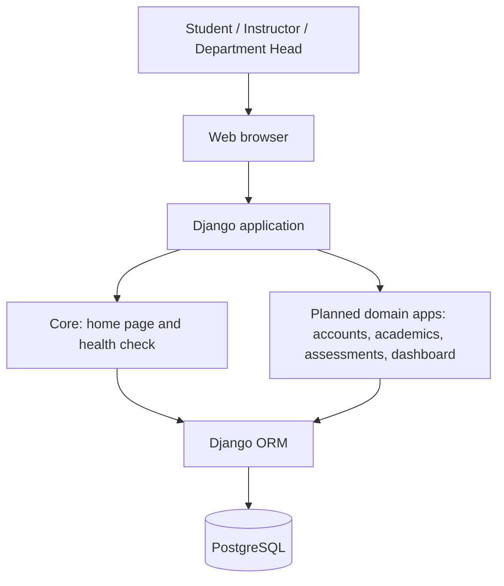
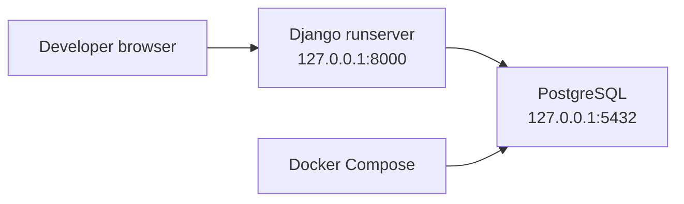

# StraitAI System Architecture

## Scope and current state

StraitAI is a Django web application for evaluating student learning outcomes
(LOs) and program outcomes (POs). This document records the development
architecture as of the initial project foundation.

The web shell, health endpoint, PostgreSQL configuration, and local database
Compose service are implemented. The academic domain apps, authentication
policies, score calculations, and reporting screens are planned work; they are
shown as such below.

## Logical architecture

## Local development deployment

`compose.yaml` manages only the PostgreSQL service. Django runs directly from
the project virtual environment with `uv run python manage.py runserver`.
Both Compose and Django read their connection settings from the ignored local
`.env` file.

## Responsibility boundaries

| Layer | Responsibility | Current state |
| --- | --- | --- |
| Browser and templates | Present dashboards and role-specific workflows | Mock homepage implemented; role-specific pages planned |
| Django views and services | Validate requests, enforce access, and coordinate use cases | Health and mock-home views implemented |
| Domain services | Calculate LO/PO scores deterministically from grades and mappings | Planned; no calculation data is stored as editable truth |
| Django ORM and migrations | Maintain the normalized transactional schema | PostgreSQL connection configured; project domain schema planned |
| PostgreSQL | Persist users, academic data, mappings, assessments, and grades | Local Docker service configured |

## Planned data flow

1. An authorized instructor enters or imports grades for an assessment.
2. Assessment-to-LO weights calculate the affected course LO scores.
3. LO-to-PO weights calculate course PO scores.
4. Course-to-PO weights combine valid contributing course scores into a
   student's PO profile.
5. The dashboard displays derived values; it never becomes an independent
   source of score truth.

The calculation rules use normalized weighted averages and exclude missing or
invalid contributors from both numerator and denominator. The detailed class
and relationship design is maintained in `docs/domain-model.md` when DT-02 is
completed.
