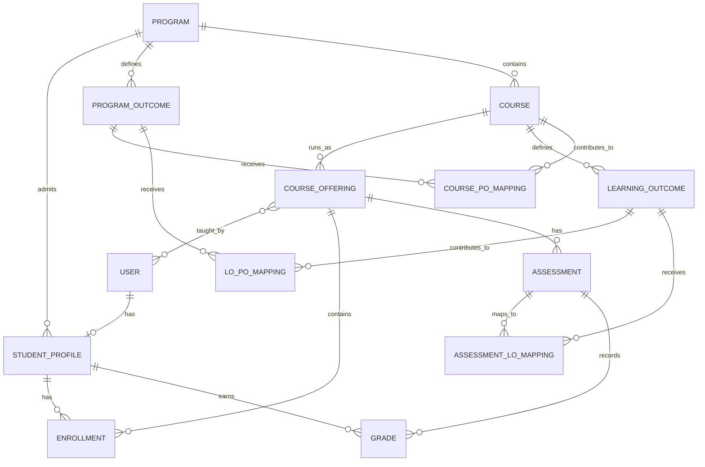
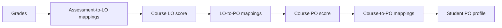

# StraitAI Domain Model

## Design decisions

- Use Django's built-in `auth.User`; do not introduce a custom user model after
  the initial Django migrations have been applied.
- Authorize people with the `Student`, `Instructor`, and `Department Head`
  Django groups. A `StudentProfile` adds the stable student number and program
  membership that the built-in user does not provide.
- Keep grades and relationship weights as the only editable scoring inputs.
  LO and PO scores are derived by services and are not persisted as independent
  editable records.
- Treat a missing grade as absent, not as zero. A score with no positive valid
  contributors is undefined.
- Use a `DecimalField` for grades and weights. Display rounding happens only at
  the dashboard or export boundary.

## Entity relationship diagram

## Model responsibilities and constraints

| Model | Essential fields | Key integrity rules |
| --- | --- | --- |
| `Program` | `code`, `name` | `code` is unique. One source of truth for the department's program. |
| `ProgramOutcome` | `program`, `code`, `description`, `is_active` | Unique `(program, code)`. The CSE program can define its configured set of POs here. |
| `Course` | `program`, `code`, `title`, `credit_hours` | Unique `(program, code)`; credit hours must be positive. |
| `AcademicTerm` | `year`, `season` | Unique `(year, season)`; represents a course delivery period. |
| `CourseOffering` | `course`, `term`, `section`, `instructors` | Unique `(course, term, section)`. Instructors are scoped to their assigned offering. |
| `LearningOutcome` | `course`, `code`, `description` | Unique `(course, code)`. LOs are owned by a course. |
| `StudentProfile` | `user`, `program`, `student_number` | One-to-one with `User`; `student_number` is unique. |
| `Enrollment` | `student`, `offering`, `status` | Unique `(student, offering)`. A grade is valid only for an enrolled student. |
| `Assessment` | `offering`, `title`, `kind`, `max_score` | `max_score` must be greater than zero. |
| `Grade` | `assessment`, `student`, `score` | Unique `(assessment, student)`; score must be from zero through the assessment maximum. |
| `AssessmentLOMapping` | `assessment`, `learning_outcome`, `weight` | Unique `(assessment, learning_outcome)`; non-negative weight; LO must belong to the offering's course. |
| `LOPOMapping` | `learning_outcome`, `program_outcome`, `weight` | Unique `(learning_outcome, program_outcome)`; non-negative weight; both belong to the same program. |
| `CoursePOMapping` | `course`, `program_outcome`, `weight` | Unique `(course, program_outcome)`; weight is the configured cross-course PO contribution on the 1–5 scale. |

## Score derivation

For every calculated level, the service uses a normalized weighted average:

`sum(weight × score) / sum(weight)`

The numerator and denominator use exactly the same valid, positive-weight
contributors. Missing grades are excluded from both. The calculation service
returns an undefined result rather than dividing by zero when there are no
valid contributors.

## Ownership and access policy

| Group | Allowed responsibility |
| --- | --- |
| Department Head | Maintain programs, POs, courses, LOs, mappings, terms, and course-offering instructor assignments. |
| Instructor | View assigned offerings; create assessments and enter grades only for students enrolled in those offerings. |
| Student | View only their own enrollment, grades, and derived LO/PO profile. |

The server must enforce these scopes. Hiding a navigation item is not an access
control mechanism.

## Implementation sequence

1. Create `academics` with program, term, course, offering, LO, PO, and mapping
   models plus constraints and admin registration.
2. Create `accounts` with groups, `StudentProfile`, and enrollment-aware access
   helpers.
3. Create `assessments` with assessment and grade models plus validation.
4. Add a pure score-calculation service and exhaustive unit tests before wiring
   derived scores into views.
